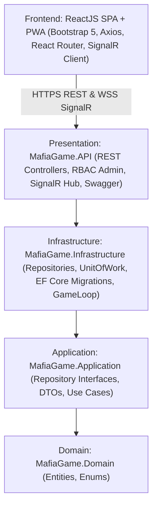

# 🕵️ Mafia Online — Full-Stack React PWA + ASP.NET Core 10 Clean Architecture


A full-stack, mobile-installable (**Progressive Web App**) real-time multiplayer social deduction game built with **ReactJS, Bootstrap 5, Axios, React Router, C# ASP.NET Core 10 Web API, SignalR WebSockets, Entity Framework Core (MS SQL Server Code-First Migrations + SQLite container fallback), Repository Pattern + Unit of Work, JWT Authentication & RBAC**.

🌐 **Live Installable Mobile App:** [https://mafia-game-backend-7bp2.onrender.com](https://mafia-game-backend-7bp2.onrender.com)  
📑 **Live Swagger API Docs:** [https://mafia-game-backend-7bp2.onrender.com/swagger](https://mafia-game-backend-7bp2.onrender.com/swagger)

---

## 📱 Installable Mobile App Experience (PWA)
Open the live URL on any **Android (Chrome)** or **iPhone (Safari)** device and tap **Install App / Add to Home Screen**:
- Launches **full-screen standalone** with custom Mafia Online icon (no browser bar).
- Native mobile app layout with fixed Top App Bar, Bottom Tab Navigation (`Play`, `Ranks`, `Admin`, `Profile`), tap-to-hide Secret Role card, countdown timer, and one-tap Vote / Night Target controls.

---

## 🏛️ Full-Stack Clean Architecture



---

## ✨ Enterprise Stack Highlights

1. **Frontend (ReactJS Mobile-First PWA)**:
   - **React 18 + Vite** with Hooks (`useState`, `useEffect`, `useContext`, `useRef`).
   - **React Router v6** with protected routes & Admin RBAC route guard.
   - **Axios** centralized API client with JWT Bearer request interceptor & `401` session-expiry handler.
   - **Bootstrap 5** dark neon theme + PWA `manifest.webmanifest` + Service Worker (`sw.js`).
2. **Backend (ASP.NET Core 10 Clean Architecture)**:
   - **Repository Pattern & Unit of Work** (`IRepository<T>`, `IUserRepository`, `IRoomRepository`, `ILeaderboardRepository`, `IUnitOfWork`).
   - **JWT Authentication + Role-Based Access Control (RBAC)** (`Admin` & `Player` roles with `[Authorize(Roles = "Admin")]`).
   - **SignalR Real-Time Engine** + 60-second disconnection grace period (`IGracePeriodManager`).
   - **Background Worker (`GameLoopBackgroundService`)** ticking every 2 seconds for automated Day/Night phase transitions.
3. **Database & Migrations**:
   - **Microsoft SQL Server** Code-First EF Core Migrations (`src/MafiaGame.Infrastructure/Migrations/`) with automatic `Database.Migrate()`.
   - Seamless SQLite fallback for zero-config Docker / free-tier cloud containers.
4. **DevOps & CI/CD**:
   - **Multi-Stage Dockerfile** (Stage 1: Node 22 React PWA build → Stage 2: .NET 10 SDK publish → Stage 3: ASP.NET Core 10 runtime).
   - **GitHub Actions CI** building and testing both React frontend and .NET xUnit suite.

---

## ⚡ Quickstart Guide (Local Execution)

```bash
# 1. Build React PWA Frontend
cd client
npm install
npm run build
cd ..

# 2. Run Automated xUnit Tests
dotnet test MafiaGameBackend.slnx

# 3. Launch ASP.NET Core Web API + React PWA
dotnet run --project src/MafiaGame.API/MafiaGame.API.csproj
```

To run with **Microsoft SQL Server**, set `DatabaseProvider` to `"SqlServer"` and configure `ConnectionStrings:DefaultConnection` in `appsettings.json` (or Azure App Service Configuration).
